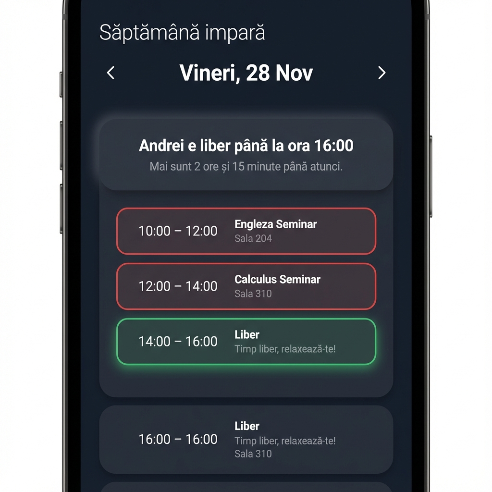

# IamBusy 📅


**IamBusy** is a sleek, mobile-first web application designed to keep your university schedule organized and accessible. It automatically detects odd/even weeks, displays your daily timeline, and provides real-time status updates so you (and others) know exactly when you're free.



> **Accounts edition** — a copy of IamBusy where every person has their own
> account and private schedule. Live at **[www.iambusy.ro](https://www.iambusy.ro/)**.
> Visitors only see the home page, the legal pages and the share links people
> send them; everything else needs an account.

## 🌐 Public website

-   **Home page** (`/` when logged out): what the app does, with sign-in and "Am o invitație" buttons. Logged-in users get their calendar at the same address.
-   **Legal pages**: privacy policy (`/confidentialitate`, GDPR) and terms (`/termeni`), linked in every footer and on the sign-up form. Operator name and contact come from `OPERATOR_NAME` / `CONTACT_EMAIL`; bump `public.LEGAL_UPDATED` whenever their text changes.
-   **Email is required**: sign-up asks for an address and the account opens once its confirmation link is clicked; accounts created earlier see a "IamBusy now needs your email" screen at their next login (logging out, exporting data and deleting the account stay possible there). The address is attached only after the click, so nobody can point an account at a mailbox they don't control. Emails go out through Brevo's API (`mailer.py`, `BREVO_API_KEY`) on a background thread; without a key the requirement is off.
-   **Forgotten password**: `/forgot` sends a reset link (single-use, valid for an hour, stored only as SHA-256, replaced by newer ones and cancelled by a password change); the page answers the same whether or not the account exists. Resetting logs every device out and sends a notice. Rate limits: 5 requests / 15 min per IP, 3 emails / hour per account.
-   **Notification emails** (`emails.py`): friend requests and activity invites — with Accept / Decline buttons that work without logging in (signed personal link, 14 days, invalid once the address changes; opening it changes nothing, the buttons do) — plus answers to yours and changed / cancelled activities. Each kind can be switched off on the account page or with the one-click unsubscribe link (RFC 8058 `List-Unsubscribe`). Limits: the same request / invite at most once a day, 3 change emails an hour per activity, 30 notification emails a day per recipient, and 250 emails a day for the whole site (Brevo's free plan sends 300).
-   **Your data**: the account page has *Descarcă datele mele* (everything stored about you as JSON, without password / token / PIN hashes) and *Șterge-mi contul definitiv* (password required; the last active admin can't delete themselves).
-   **One address**: with `SITE_URL` set, any other host name and plain `http://` get a 301 (308 for form posts) to it, and copied links are built from it. Requests by IP or to `localhost` are left alone.
-   **Search & previews**: `robots.txt`, `sitemap.xml`, canonical links, Open Graph / Twitter cards (share links and friend links get their own titles; PIN-protected links reveal nothing), JSON-LD, a web app manifest with PNG / maskable icons and `favicon.ico`.
-   **Error pages**: branded 404 / 405 / 500 … pages; `/api/` routes answer with JSON instead.
-   **`/.well-known/security.txt`** (RFC 9116) with the contact address.
-   **Cache busting**: CSS / JS URLs carry a content hash (`?v=…`), so an update is never mixed with stale files cached by browsers or Cloudflare.
-   **No third parties in the page**: the fonts (Space Grotesk, IBM Plex Mono — OFL) are served from `static/fonts/`, so the CSP is `'self'` only and no cookie banner is needed (only strictly necessary cookies).

## 🔐 Accounts & security

-   **Sign-up**: open to anyone with a confirmed email (Cloudflare Turnstile on the form when configured). The admin panel can switch to invite-only in one click — then an invite code (single- or multi-use, optional expiry, revocable) or a friend link is needed.
-   **Log in** with the username or the confirmed email address (rate limits count per account either way).
-   **Stay signed in**: a device is remembered for 30 days after its last visit ("Ține-mă minte"); untick it on shared computers for a 12-hour session.
-   **Account page** (`/account`): display name, week-1 date, password change, and a list of connected devices you can log out one by one.
-   **Admin panel** (`/admin`): manage invite codes; disable / re-enable, log out, reset the password of, or delete accounts. The admin cannot read other people's schedules.

| Measure | How |
|---|---|
| Password storage | scrypt (salted, memory-hard); 10–128 characters, common passwords and passwords containing your name are refused |
| Session tokens | 256-bit random, `HttpOnly` + `SameSite=Lax` + `Secure` cookie; only the SHA-256 is stored, so a leaked database can't be replayed |
| Revocation | sessions live server-side: logout, password change, reset or disabling an account kills them immediately |
| CSRF | per-session token on every form and API call, plus a same-origin `Origin` check |
| Brute force | failed logins limited per IP+account (5 / 15 min), per account and per IP; a browser that has logged in to the account before (`iambusy_device` cookie) isn't held by the per-account limit, so nobody can lock the owner out on purpose; sign-ups (successful ones too) and invite-code guesses limited per IP; at most 10 accounts a day through one person's friend links |
| Enumeration | identical answer and timing for unknown user / wrong password / disabled account |
| Data isolation | every query is scoped to the logged-in user id |
| Browser hardening | strict Content-Security-Policy (no inline scripts, nothing loaded from other sites), `X-Frame-Options: DENY`, `nosniff`, HSTS, `Cache-Control: no-store` |
| On disk | `schedule.db`, `.secret_key` and `schedule_config.py` are mode `0600` and ignored by git |
| Friends' calendars | only accepted friends can open them; everything they see goes through one masking layer (`calendar_data.py`), so "busy" blocks never carry a title, place, category or participant list, and overlapping busy blocks are merged |
| Search | exact username only (no browsing), 40 lookups / 10 min per user (friend requests by username count too); blocked users look like unknown ones; you can only block people you have a request or friendship with |
| Invites | the creator's privacy follows their activity: if they don't show it in full to all their friends, participants' friends and links see only "busy"; someone who declined is an ordinary friend again |
| Deleted data | `secure_delete` overwrites removed rows; daily backups are kept 14 days |
| Share links | 128-bit random token, revocable / regenerable; optional scrypt-hashed PIN limited to 5 tries / 15 min per visitor, 30 / hour and 100 / day per link; `noindex`; dates outside the link's window are never sent, not even to the status line |

```bash
python3 accounts.py create-admin              # first administrator (asks for the password)
python3 accounts.py reset-password USERNAME   # forgot-password rescue, run on the server
python3 accounts.py import-schedule USERNAME /path/to/old/schedule.db
python3 accounts.py list
python3 accounts.py backup [KEEP]             # online copy into backups/ (keeps 14) + daily cleanup
```

A daily cron job runs the backup (and drops rate-limit records older than a day):

```
17 4 * * * cd /home/andrei/iambusy-auth && /usr/bin/python3 accounts.py backup 14 >/dev/null 2>>backups/backup-errors.log
```

## 👥 Friends & sharing

-   **Friends**: send a request by exact username (yours is on the Prieteni page with a copy button) or hand out a **friend link** (max uses, optional expiry). Whoever opens it becomes your friend in one click — and, if the admin allows it, can create an account straight from the link without an invite code.
-   **Categories**: every activity has one of your own categories (Curs, Seminar, Laborator, Personal, Altele to start with — rename, recolour, add, delete). Existing activities were sorted into them from their `(C)` / `(S)` / `(L)` tag.
-   **Who sees what** (`/privacy`): each category has a level for friends — **Complet** (title, place, time), **Doar ocupat** (a red "Ocupat" block, no details) or **Ascuns** (not shown at all, you look free). Override it for a **group** of friends (groups are private to you), for a single **friend**, or on a single **activity** in the editor. The most specific rule wins: activity → friend → groups → all friends → default (*Doar ocupat*); when two groups disagree, the more private level wins. "Vezi cum te vede" previews your calendar exactly as a given friend sees it.
-   **Friends' calendars**: open a friend to get the same day view, week strip and month calendar as your own — filtered by what they allow you to see — and a live "liber / ocupat până la …" list on the Prieteni page.
-   **Inviting friends**: add invitees to any activity. They answer from the Prieteni page or the editor and pick a category for it in *their* calendar, so their own rules decide what their friends see (that they're busy, at least). Only the organiser edits it; changes and cancellations reach everyone; anyone can leave. Participants see each other's RSVP.
-   **One-off events and ranged activities**: an activity is either weekly (odd / even / both, optionally only between two dates) or happens once on a given date. The editor's **Calendar** tab shows real weeks and can overlay friends' busy blocks.
-   **Common free time** (`/friends/free-time`): pick friends and a week to see where everyone is free (hidden activities count as free), then invite them to a slot in one click.
-   **Public share links** (`/shares`): let anyone see your schedule without an account. Choose what they see (only busy / free, all details, or the same as your friends — adjustable per category), which days (any, from X to Y, the next N days, or hand-picked dates), until when the link works, an optional PIN and whether to show the live status. See how many times it was opened; disable, regenerate or delete it at any time.
-   **Notifications**: the friends button in the top bar counts requests, invites and news (accepted, changed, cancelled …).

## ✨ Features

-   **Smart Scheduling**: Automatically toggles between Odd and Even week schedules based on a configurable academic start date.
-   **Real-Time Status**: Instantly see if you are currently in a course or on a break, with a precise countdown to the next event.
-   **Live Clock**: A prominent clock that updates every second — no need to refresh.
-   **Day Navigation**: Switch days with **Previous/Next arrows**, the **week strip**, keyboard (`←` `→` `T` `C`) or swipe.
-   **Month Calendar with Busy Bars**: A custom date picker where every day shows a tiny 07:00–22:00 bar of its courses (colour-coded by type) and the academic week number. Tap a day to preview its full timeline and free windows *before* you commit to it, then open it or jump straight to "schedule something here".
-   **Free Windows at a Glance**: Each day lists its gaps between courses, and every gap has an **Adaugă** shortcut that opens the editor pre-filled with that day, week parity and time slot.
-   **Neobrutalist UI**: Thick borders, hard offset shadows, flat saturated colour and heavy type. Dark theme by default; visitors get a light / dark switch (remembered per device).
-   **Colour Themes** (`/account/theme`): 14 presets inspired by terminal themes (Catppuccin Mocha / Latte, Dracula, Nord, Gruvbox, Tokyo Night, Rosé Pine, One Dark, Solarized Light, Everforest, an all-pink one, an all-purple dark one…). Tap one to try it on the whole page, then use it, or tweak any of them / start from scratch in the editor (13 colours, live preview, contrast warnings) and save up to 12 of your own. The choice is stored on the account, so it follows you to every device.
-   **Mobile Optimized**: Constant-height bottom-sheet calendar (day preview always in view, swipe for months, drag down to close), swipe between days, long-press to move cards in the editor, bottom-sheet forms with Save always visible.

### 🗓️ Schedule Management

A full-featured management page (`/manage`) lets you take control of your schedule:

-   **Weekly Grid View**: See all your activities laid out on a 7-day × 15-hour grid, with separate tabs for Odd and Even weeks.
-   **Add Activities**: Click any empty cell or use the **+** button to add a new activity with a name, day, time, and week type.
-   **Edit Activities**: Click on any existing activity card to edit its details.
-   **Drag & Drop**: Grab any activity card and drag it to a new time slot or day — duration is preserved automatically. On touch screens, hold the card for a moment to pick it up (a plain swipe scrolls the grid).
-   **Delete Activities**: Remove activities with a single click and confirmation dialog.
-   **Conflict Detection**: When adding or moving an activity into an occupied time slot, a warning dialog shows the conflicting activities and gives you two options:
    -   **Delete the conflicting activity** and proceed with the save.
    -   **Choose another time** and go back to the form.
-   **Smart Defaults**: Setting a start time automatically sets the end time to +2 hours.
-   **Persistent Storage**: All changes are saved to a local SQLite database (`schedule.db`).

## 🏗️ Architecture

```
iambusy/
├── app.py                    # Flask HTTP layer + REST API, security headers
├── recovery.py               # Required email, confirmation, forgot / reset password
├── emails.py                 # Notification emails, Accept / Decline and unsubscribe links
├── mailer.py                 # Outgoing email through the Brevo API
├── captcha.py                # Cloudflare Turnstile check
├── public.py                 # Home page, legal pages, robots/sitemap/manifest, error pages, canonical host
├── auth.py                   # Login, registration, sessions, CSRF, rate limits, admin
├── social.py                 # Friends, groups, privacy rules, invites, friend links, free time
├── sharing.py                # Public share links (no account needed)
├── themes.py                 # Colour themes: presets, custom themes, per-user <style>
├── calendar_data.py          # A user's days as one viewer may see them (masking)
├── visibility.py             # Full / busy / hidden rule precedence
├── accounts.py               # Command-line account maintenance
├── db.py                     # SQLite layer (users, sessions, invites, categories, activities)
├── db_social.py              # SQLite layer for the social features
├── schedule_engine.py        # Business logic (recurrence, week parity, timeline, status)
├── tests/                    # pytest suite (`.venv/bin/python -m pytest`)
├── setup.sh                  # One-command install / config / systemd service
├── schedule_config.example.py # Blank config template
├── schedule_config.py        # Your settings (created by setup.sh, not in git)
├── static/
│   ├── style.css             # Neobrutalist design system (tokens, components)
│   ├── fonts/                # Self-hosted woff2 fonts + fonts.css
│   ├── icons/                # App icons, Open Graph image
│   ├── favicon.ico
│   ├── schedule.js           # Live clock, month calendar, navigation, theme
│   ├── manage.js             # Schedule management UI (grid, drag & drop, modals, invites)
│   ├── social.js             # Small helpers for the privacy / share pages
│   ├── freetime.js           # Common free time finder
│   ├── auth.js               # Password reveal / strength meter, copy buttons
│   └── theme.js              # Applies the saved theme before first paint
├── templates/
│   ├── index.html            # Day view (own, friend's, preview, public share)
│   ├── landing.html          # Public home page
│   ├── legal_base.html / legal_privacy.html / legal_terms.html / error.html
│   ├── _head_assets.html / _seo.html / _footer.html  # Shared head, link-preview meta, footer
│   ├── friends.html / privacy.html / shares.html / freetime.html / notifications.html
│   ├── friend_link.html / share_pin.html / share_gone.html
│   ├── manage.html           # Schedule management page
│   ├── auth_base.html        # Shared layout of the account pages
│   ├── login.html / register.html
│   └── account.html / admin.html
├── .gitignore
├── requirements.txt
└── README.md
```

> **Note:** `schedule_config.py`, `schedule.db`, `.secret_key`, `.venv/`, `__pycache__/`, and `.DS_Store` are excluded from version control via `.gitignore`.

## 🚀 Getting Started

You need Python 3.9+ (on Debian/Ubuntu also `sudo apt install python3-venv`).

### Quick start

```bash
git clone https://github.com/andreinita21/iambusy.git
cd iambusy
./setup.sh
```

`setup.sh` asks for the first day of week 1 and a port, then:

1.  creates a virtualenv in `.venv/` and installs the dependencies,
2.  writes `schedule_config.py`,
3.  creates the SQLite database (`schedule.db`) and the `admin` account.

Start the app with the command it prints:

```bash
.venv/bin/gunicorn --bind 0.0.0.0:2027 app:app
```

Log in as `admin`, open **`/admin`**, generate an invite code and hand it to whoever should get an account. Each account builds its schedule from scratch in **`/manage`**.

### Hosting (keep it running)

```bash
./setup.sh --service
```

This asks for your sudo password and installs a systemd service (`iambusy-auth.service`) that starts at boot and restarts automatically if the app ever dies. If a unit with that name already exists, the script asks before replacing it and keeps a `.bak` copy.

```bash
systemctl status iambusy-auth        # is it running?
journalctl -u iambusy-auth -f        # live logs
sudo systemctl restart iambusy-auth  # after changing schedule_config.py or updating
```

The default configuration expects **HTTPS in front of the app** (Cloudflare tunnel or a reverse proxy): cookies are marked `Secure`, so logging in over plain `http://` does not work. For HTTP-only use on a LAN set `COOKIE_SECURE = False`.

### Setup options

| Option           | Description                                              |
|------------------|----------------------------------------------------------|
| `--start DATE`   | Default first day of week 1 for new accounts, `YYYY-MM-DD` |
| `--port PORT`    | Port to listen on (default: `2027`)                      |
| `--service`      | Install and start the systemd service (needs sudo)       |
| `-y`, `--yes`    | No questions, use defaults for anything not given        |

Re-running `./setup.sh` is safe: an existing `schedule_config.py` and `schedule.db` are never overwritten.

### Updating

```bash
git pull
./setup.sh                      # installs any new dependencies
sudo systemctl restart iambusy-auth  # if you use the service
```

### Tests

```bash
python3 -m venv --system-site-packages .venv && .venv/bin/pip install pytest
.venv/bin/python -m pytest
```

The suite uses a throw-away database per test (`IAMBUSY_DB`) and never touches `schedule.db`.

### Development

Set `DEBUG = True` in `schedule_config.py` and run `.venv/bin/python app.py` for auto-reload and the Flask debugger. Never do this on a host other people can reach.

### API Endpoints

All endpoints need a logged-in session and only ever touch the caller's own schedule; `POST` / `PUT` / `DELETE` also need the `X-CSRF-Token` header (the value is in the page's `<meta name="csrf-token">`).

| Method   | Path                     | Description                        |
|----------|--------------------------|------------------------------------|
| `GET`    | `/api/activities`        | List all activities (JSON)         |
| `POST`   | `/api/activities`        | Add a new activity                 |
| `PUT`    | `/api/activities/<id>`   | Update / move an activity          |
| `DELETE` | `/api/activities/<id>`   | Delete an activity                 |
| `POST`   | `/api/conflicts`         | Check for time conflicts           |
| `GET`    | `/api/days?from=&to=`    | Per-day summaries (max 62 days) for the month calendar |
| `GET`    | `/api/manage/context`    | Categories, friends, groups and activities you were invited to |
| `PUT`    | `/api/shared/<id>`       | Your category / visibility for an activity you were invited to |
| `POST`   | `/api/shared/<id>/respond` · `/leave` | Accept / decline an invite, or leave |
| `GET`    | `/api/friends/<username>/days?from=&to=` | A friend's days, as they let you see them |
| `GET`    | `/api/busy?users=&from=&to=` | Busy intervals of you and friends + common free slots (max 14 days) |
| `GET`    | `/s/<token>/days?from=&to=` | A share link's days (public; PIN-unlocked session if the link has a PIN) |

Activities accept, besides `title` / `day` / `start_time` / `end_time` / `week_type`: `category_id`, `date` (one-off event; its weekday is derived), `valid_from` / `valid_until` (range of a weekly activity), `rules` (`[{subject_type: all|group|friend, subject_id, level: full|busy|hidden}]`) and `invitees` (friend user ids).

## 🛠️ Configuration

Everything lives in `schedule_config.py` (created by `setup.sh`, ignored by git):

| Setting                | Description                                                  |
|------------------------|--------------------------------------------------------------|
| `ACADEMIC_WEEK1_START` | Default first day of week 1 for new accounts (each user can change theirs) |
| `APP_HOST`, `APP_PORT` | Where the app listens                                        |
| `DEBUG`                | Flask auto-reload + debugger, for development only           |
| `SESSION_DAYS`         | How long a remembered device stays logged in (sliding, default 30) |
| `SHORT_SESSION_HOURS`  | Session length when "remember me" is unticked (default 12)   |
| `COOKIE_SECURE`        | `True` behind HTTPS (default); `False` only for plain-HTTP LAN use |
| `TRUSTED_PROXIES`      | Networks allowed to report the visitor IP (`CF-Connecting-IP`) and scheme (`X-Forwarded-Proto`) |
| `SITE_URL`             | The public address, e.g. `https://www.iambusy.ro` — canonical redirect + copied links (`""` = off) |
| `OPERATOR_NAME`, `CONTACT_EMAIL` | Who runs the site, shown in the footer and the legal pages |
| `TURNSTILE_SITE_KEY`, `TURNSTILE_SECRET_KEY` | Cloudflare Turnstile on sign-up and "forgot password" (empty = off) |
| `BREVO_API_KEY`, `MAIL_FROM` | Brevo API key and sender for password-reset emails (`MAIL_FROM` defaults to `noreply@<domain>`) |

Restart the app after editing it. Schedules are stored in `schedule.db` and edited through `/manage`.

## 📦 Tech Stack

-   **Backend**: Flask (Python), served by gunicorn
-   **Database**: SQLite (via `db.py`)
-   **Frontend**: HTML5, CSS3 (Custom Design System), JavaScript
-   **Templating**: Jinja2

## 📄 License

This project is licensed under the MIT License - see the [LICENSE](LICENSE) file for details.
