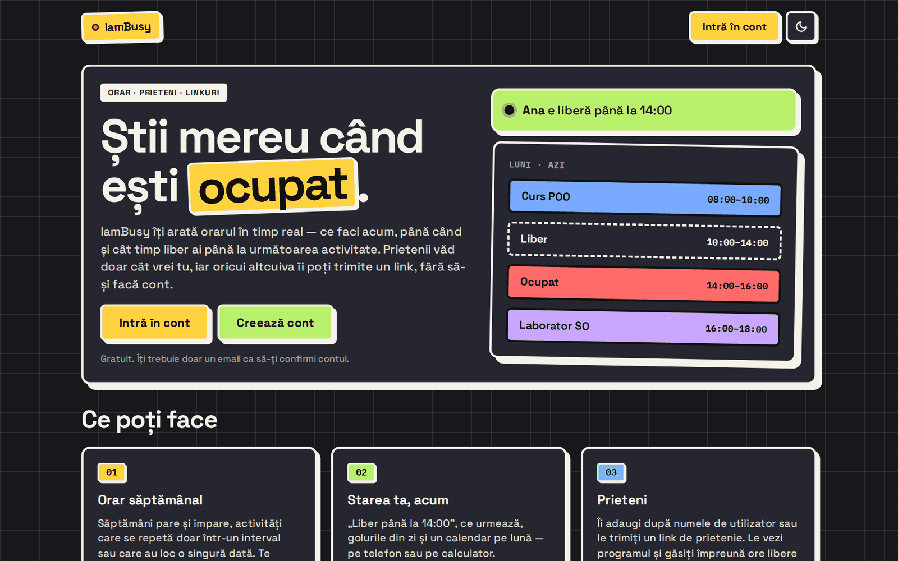
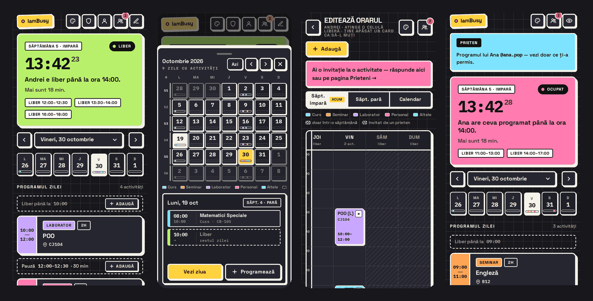
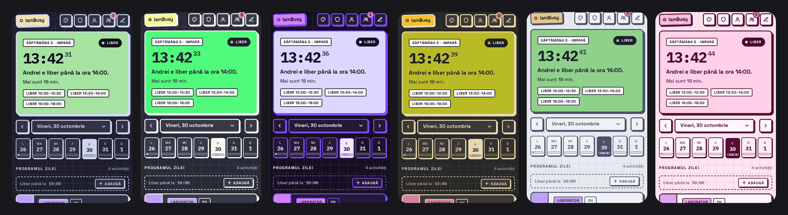
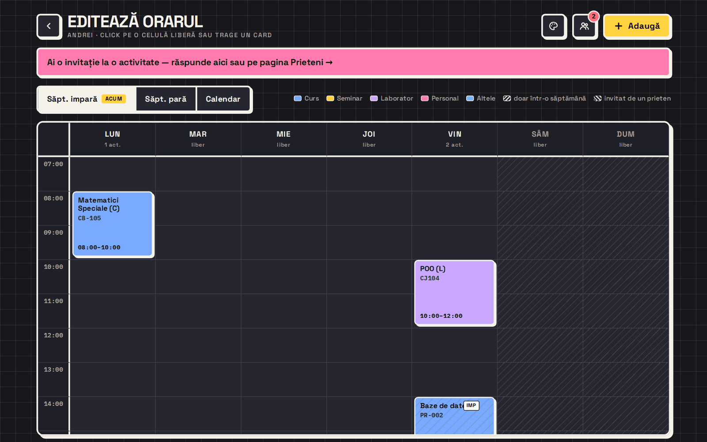
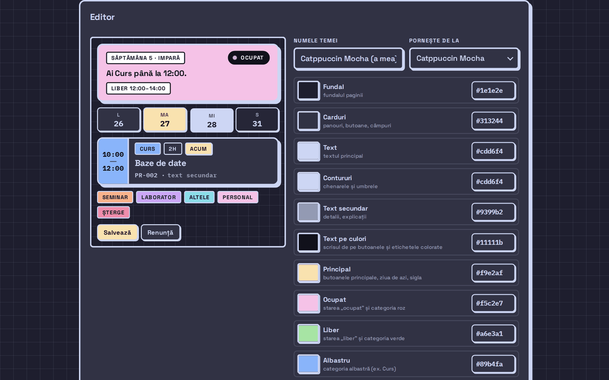
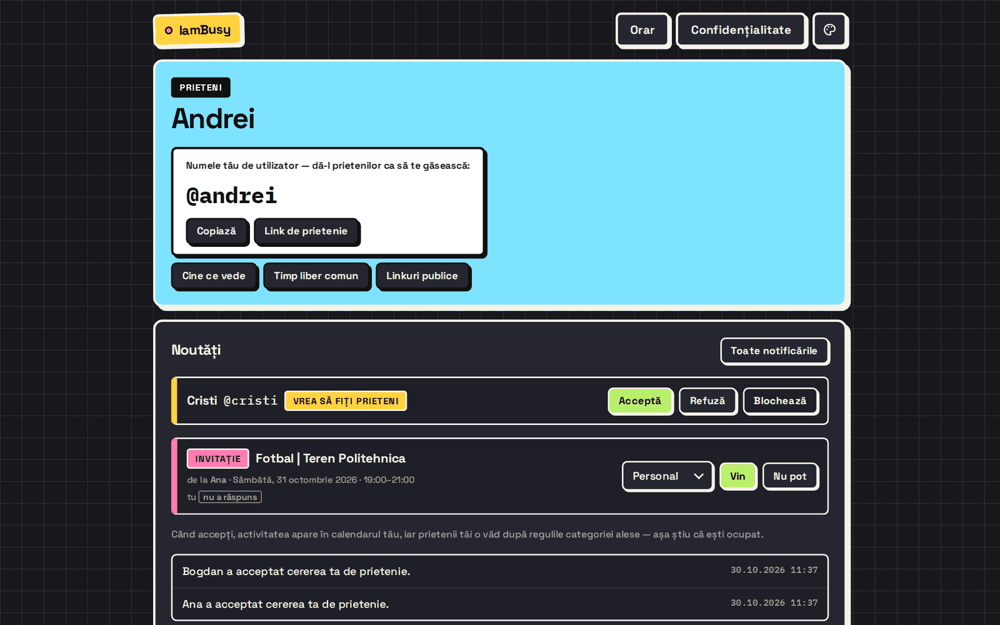

<div align="center">


# IamBusy

**Know at a glance when you — and your friends — are busy or free.**

A mobile-first weekly planner for students: odd / even weeks, a live “busy until…” status,
friends who see exactly as much of your schedule as you allow, and links you can send to anyone.

### 🌐 Live and free to use at **[www.iambusy.ro](https://www.iambusy.ro/)**

[](https://www.iambusy.ro/)


[Open the app](https://www.iambusy.ro/) · [Features](#-features) · [Screenshots](#-screenshots) · [Privacy & security](#-privacy--security) · [Self-hosting](#-self-hosting)

<br>



</div>

---

## 👋 What is it?

IamBusy started as a one-person timetable and grew into a small public service. Anyone can
make an account at **[www.iambusy.ro](https://www.iambusy.ro/)** (it only needs a confirmed email address), build their
week, and then:

- 🟢 see **right now** whether they're free or busy, and until when;
- 👥 add friends and see when **they** are free — only as much as each friend allows;
- 🗓️ find a slot when **everyone** is free and invite them to it in one click;
- 🔗 send a **public link** of their schedule to someone without an account;
- 🎨 make the whole site look the way they like, from Catppuccin to all-pink.

The interface is in Romanian 🇷🇴. It's free, with no ads and no trackers.

## 📸 Screenshots

<p align="center">
  
  <br><sub>On a phone: the day view with a live status · the month calendar sheet · the weekly editor · a friend's calendar (only “busy”, no details)</sub>
</p>

<p align="center">
  
  <br><sub>Same page, six of the 14 built-in themes: Catppuccin Mocha · Dracula · Ametist · Gruvbox · Catppuccin Latte · Bubblegum</sub>
</p>

<table>
  <tr>
    <td width="50%"><br><sub><b>Weekly editor</b> — odd / even weeks, drag & drop, conflict checks</sub></td>
    <td width="50%"><br><sub><b>Theme editor</b> — 14 colours, live preview, contrast warnings</sub></td>
  </tr>
  <tr>
    <td width="50%"><br><sub><b>Friends</b> — requests, invites and who's free right now</sub></td>
    <td width="50%" align="center"><br><b><a href="https://www.iambusy.ro/">➜ Try it live at www.iambusy.ro</a></b><br><br><sub>No install, works in any browser and can be added to the home screen.</sub><br><br></td>
  </tr>
</table>

## ✨ Features

### 🗓️ Your schedule

- **Odd / even weeks** worked out from your own “first day of week 1”.
- **Live status** — *“Ai Curs până la 12:00”*, a ticking clock and the free windows of the day.
- **Weekly, ranged or one-off** activities: every week, odd / even only, only between two dates, or once on a given date.
- **Month calendar with busy bars** — each day shows a tiny 07:00–22:00 bar of its activities; tap a day to preview it before opening it.
- **Free windows at a glance** — every gap has an *Adaugă* shortcut that opens the editor already filled in.
- **Weekly editor** (`/manage`) — tap an empty cell to add, drag cards to move them (hold-to-drag on touch), automatic conflict detection, and a *Calendar* tab with real weeks and your friends' busy blocks on top.
- **Your own categories** — rename, recolour, add or delete them (Curs, Seminar, Laborator, Personal, Altele to start with).

### 👥 Friends & sharing

- **Friends** by exact username or with a **friend link** (max uses, optional expiry).
- **Who sees what** (`/privacy`) — per category, group of friends, single friend or single activity: **Complet** (everything), **Doar ocupat** (a “busy” block, no details) or **Ascuns** (you look free). The most specific rule wins, and *“Vezi cum te vede”* shows your calendar exactly as one friend sees it.
- **Friends' calendars** — the same day view, week strip and month calendar, filtered by what they allow.
- **Invites** — add friends to an activity; they accept or decline (also straight from the email) and file it under one of *their* categories, so their own privacy rules still apply.
- **Common free time** (`/friends/free-time`) — pick friends and a week, see where everyone is free, invite them to a slot.
- **Public share links** (`/shares`) — busy / free only or full details, for chosen days, until a date, with an optional PIN; see how often it was opened, revoke it any time.
- **Notifications** in the app and by email (each kind can be turned off, one-click unsubscribe).

### 🎨 Make it yours

- **14 built-in themes** inspired by terminal and editor themes: Catppuccin Mocha & Latte, Dracula, Nord, Gruvbox, Tokyo Night, Rosé Pine, One Dark, Solarized Light, Everforest, Bubblegum (all pink), Ametist (all purple) and the two IamBusy originals.
- **Try before you choose** — tap a theme and the whole page changes; keep it or go back.
- **Theme editor** — change any of the 14 colours (background, cards, text, outlines, the busy / free colours, the category colours…) or start from scratch, with a live preview and warnings when text gets hard to read. Keep up to 12 of your own.
- Saved on the account, so it follows you to every device — even the phone's browser bar matches.

### 📱 Built for phones

- Bottom-sheet month calendar with a fixed height: the day preview is always in view, swipe for the next month, drag down to close.
- Swipe between days; hold a card to move it in the editor (a normal swipe scrolls), with auto-scroll at the edges.
- Forms open as bottom sheets with *Salvează* always visible; no zoom-on-focus on iOS; installable as a home-screen app.

## 🔐 Privacy & security

IamBusy is built so that a friend, a share link or even the administrator only ever sees what the owner chose to show.

| | |
|---|---|
| **Passwords** | scrypt (salted, memory-hard), 10–128 characters; common passwords and passwords containing your name are refused |
| **Sessions** | 256-bit random tokens in `HttpOnly` + `SameSite=Lax` + `Secure` cookies; only their SHA-256 is stored; logout, password change or reset ends them immediately; see and log out your devices one by one |
| **Email** | required and confirmed by link (attached only after the click); log in with username or email; password reset by single-use link valid for an hour |
| **Masking** | everything a friend or a link sees goes through one layer (`calendar_data.py`): “busy” blocks never carry a title, place, category or participants, and overlapping ones are merged |
| **Abuse** | rate limits on logins, sign-ups, searches, PIN guesses and emails; Cloudflare Turnstile on sign-up; enumeration-safe answers; blocking |
| **Browser** | strict Content-Security-Policy (`'self'` only — no inline scripts, no CDNs, self-hosted fonts; Cloudflare Turnstile is allowed on the sign-up and password-reset forms only), `X-Frame-Options: DENY`, HSTS, `nosniff`, CSRF tokens on every form and API call |
| **Your data** | download everything as JSON or delete the account yourself; deleted rows are overwritten (`secure_delete`); no ads, no analytics, only strictly necessary cookies |

The details — exact limits, the visibility rule order, what each page reveals — are in the code comments and in the [privacy policy](https://www.iambusy.ro/confidentialitate).

## 🚀 Self-hosting

**www.iambusy.ro** is the public instance, but you can run your own. You need Python 3.9+ (on Debian / Ubuntu also `sudo apt install python3-venv`).

```bash
git clone https://github.com/andreinita21/iambusy.git
cd iambusy
./setup.sh              # virtualenv, schedule_config.py, database and the first admin
./setup.sh --service    # optional: systemd service that starts at boot and restarts on failure
```

`setup.sh` asks for the first day of week 1 and a port, then prints the command that starts the app
(`.venv/bin/gunicorn --bind 0.0.0.0:2027 app:app`). Re-running it is safe — an existing config and database are never overwritten.

| Option | Description |
|---|---|
| `--start DATE` | Default first day of week 1 for new accounts (`YYYY-MM-DD`) |
| `--port PORT` | Port to listen on (default `2027`) |
| `--service` | Install and start the systemd service (needs sudo) |
| `-y`, `--yes` | No questions; defaults for anything not given |

The default configuration expects **HTTPS in front of the app** (a Cloudflare tunnel or a reverse proxy): cookies are `Secure`, so logging in over plain `http://` won't work. For an HTTP-only LAN set `COOKIE_SECURE = False`.

```bash
systemctl status iambusy-auth          # is it running?
journalctl -u iambusy-auth -f          # live logs
git pull && ./setup.sh && sudo systemctl restart iambusy-auth   # update
```

<details>
<summary><b>⚙️ Configuration</b> (<code>schedule_config.py</code>, created by <code>setup.sh</code>, ignored by git)</summary>

<br>

| Setting | Description |
|---|---|
| `ACADEMIC_WEEK1_START` | Default first day of week 1 for new accounts (each user can change theirs) |
| `APP_HOST`, `APP_PORT` | Where the app listens |
| `DEBUG` | Flask auto-reload + debugger — development only, never on a reachable host |
| `SESSION_DAYS` | How long a remembered device stays logged in (sliding, default 30) |
| `SHORT_SESSION_HOURS` | Session length when “Ține-mă minte” is unticked (default 12) |
| `COOKIE_SECURE` | `True` behind HTTPS (default); `False` only for plain-HTTP LAN use |
| `TRUSTED_PROXIES` | Networks allowed to report the visitor IP (`CF-Connecting-IP`) and scheme (`X-Forwarded-Proto`) |
| `SITE_URL` | The public address, e.g. `https://www.iambusy.ro` — other hosts and `http://` redirect to it, copied links use it |
| `OPERATOR_NAME`, `CONTACT_EMAIL` | Who runs the site, shown in the footer and legal pages |
| `TURNSTILE_SITE_KEY`, `TURNSTILE_SECRET_KEY` | Cloudflare Turnstile on sign-up and “forgot password” (empty = off) |
| `BREVO_API_KEY`, `MAIL_FROM` | Brevo API key and sender for all emails (no key = email features and the email requirement are off) |

Restart the app after editing it.

</details>

<details>
<summary><b>🧰 Command-line maintenance</b> (<code>accounts.py</code>)</summary>

<br>

```bash
python3 accounts.py create-admin              # first administrator (asks for the password)
python3 accounts.py reset-password USERNAME   # rescue an account, run on the server
python3 accounts.py import-schedule USERNAME /path/to/old/schedule.db
python3 accounts.py list
python3 accounts.py backup [KEEP]             # online copy into backups/ (keeps 14) + cleanup
```

A daily cron job keeps the backups (and drops rate-limit records older than a day):

```
17 4 * * * cd /path/to/iambusy && /usr/bin/python3 accounts.py backup 14 >/dev/null 2>>backups/backup-errors.log
```

The admin panel (`/admin`) switches sign-up between open and invite-only, manages invite codes and can disable, log out, reset or delete accounts — but cannot read anyone's schedule.

</details>

<details>
<summary><b>🔌 JSON API</b></summary>

<br>

All endpoints need a logged-in session and only touch the caller's own schedule; `POST` / `PUT` / `DELETE` also need the `X-CSRF-Token` header (from the page's `<meta name="csrf-token">`).

| Method | Path | Description |
|---|---|---|
| `GET` | `/api/activities` | All your activities |
| `POST` | `/api/activities` | Add an activity |
| `PUT` | `/api/activities/<id>` | Update / move an activity |
| `DELETE` | `/api/activities/<id>` | Delete an activity |
| `POST` | `/api/conflicts` | Check for time conflicts |
| `GET` | `/api/days?from=&to=` | Per-day summaries (max 62 days) for the month calendar |
| `GET` | `/api/manage/context` | Categories, friends, groups and activities you were invited to |
| `PUT` | `/api/shared/<id>` | Your category / visibility for an activity you were invited to |
| `POST` | `/api/shared/<id>/respond` · `/leave` | Accept / decline an invite, or leave |
| `GET` | `/api/friends/<username>/days?from=&to=` | A friend's days, as they let you see them |
| `GET` | `/api/busy?users=&from=&to=` | Busy intervals of you and friends + common free slots (max 14 days) |
| `GET` | `/s/<token>/days?from=&to=` | A share link's days (public; PIN-unlocked session if it has a PIN) |

Activities accept `title`, `day`, `start_time`, `end_time`, `week_type`, plus `category_id`, `date` (one-off), `valid_from` / `valid_until`, `rules` (`[{subject_type: all|group|friend, subject_id, level: full|busy|hidden}]`) and `invitees` (friend user ids).

</details>

## 🏗️ How it's built

Plain **Flask + SQLite + vanilla JS** — no build step, no frontend framework, no CDNs.
It runs comfortably on a Raspberry Pi behind a Cloudflare tunnel, which is exactly how www.iambusy.ro is hosted.

```
app.py              Flask app, REST API, security headers
auth.py             log in, sign-up, sessions, CSRF, rate limits, admin
recovery.py         required email, confirmation, forgot / reset password
social.py           friends, groups, privacy rules, invites, friend links, free time
sharing.py          public share links
themes.py           colour themes: presets, custom themes, per-user <style>
public.py           home & legal pages, robots / sitemap / manifest, error pages, canonical host
emails.py · mailer.py   notification emails (Brevo API), one-click unsubscribe
calendar_data.py    a user's days as one viewer may see them (masking)
visibility.py       full / busy / hidden rule precedence
schedule_engine.py  recurrence, week parity, timeline, live status
db.py · db_social.py    SQLite layer (additive migrations on start-up)
accounts.py         command-line maintenance
static/             one CSS design system (neobrutalist tokens), small JS files, self-hosted fonts
templates/          Jinja2 pages
```

## 📄 License

MIT — see [LICENSE](LICENSE). Made by **Andrei Niță** · [www.iambusy.ro](https://www.iambusy.ro/)
